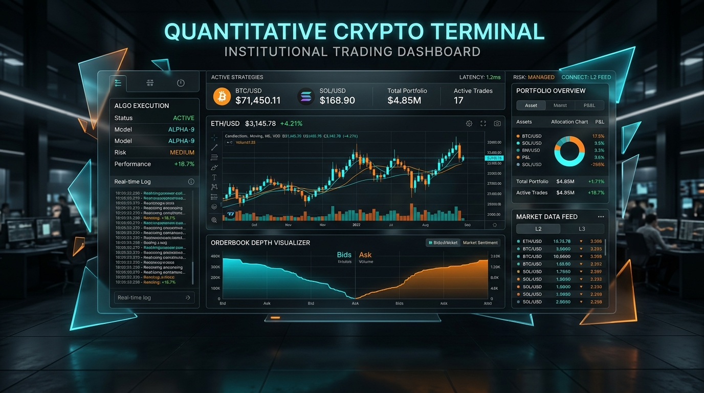
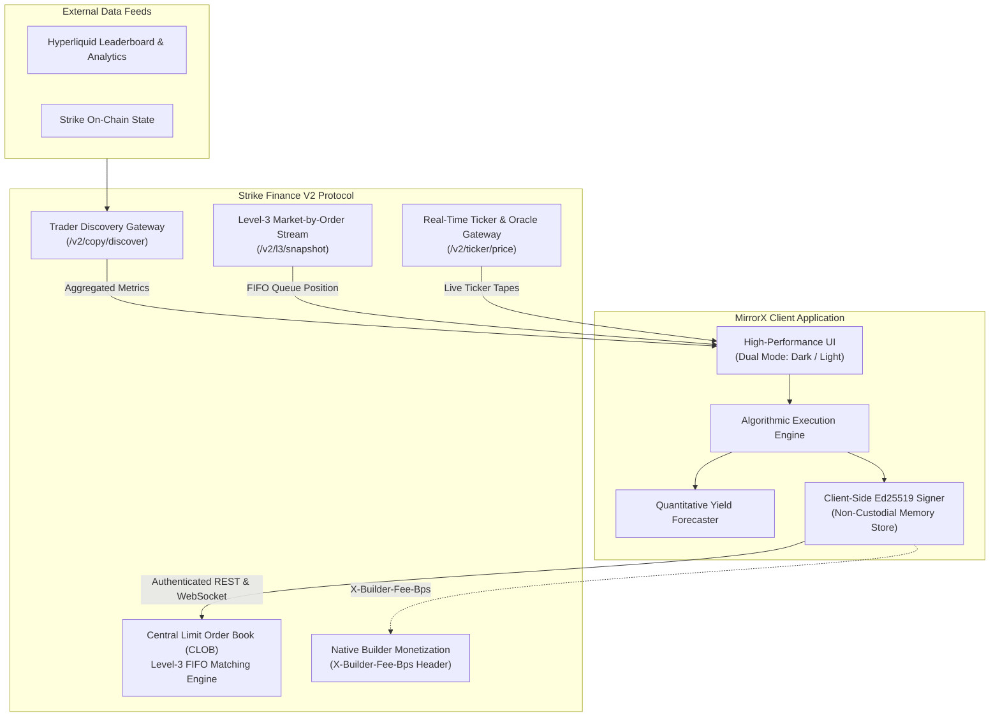

<p align="center">
  
</p>

<h1 align="center">MirrorX Protocol</h1>

<p align="center">
  <strong>Institutional Social Copy-Trading & Algorithmic Inverse Execution Engine for Strike Finance V2</strong>
</p>

<p align="center">
  <a href="https://strikefinance.org"></a>
  <a href="https://github.com/sandman-sh/MirrorX-Protocol"></a>
  
  
  
  
  
</p>

---

## Executive Summary

**MirrorX** is an enterprise-grade quantitative social trading and automated algorithmic execution platform engineered specifically for the **Strike Finance V2 Central Limit Order Book (CLOB)**. By bridging high-frequency decentralized market access with institutional portfolio controls, MirrorX transforms decentralized perpetuals trading into a deterministic, programmatic discipline.

Traditional copy-trading architectures suffer from latency degradation, front-running risks, and single-direction dependency on influencer alpha. MirrorX resolves these structural inefficiencies through two proprietary execution primitives:

1. **Alpha Mirror Engine**: Automated, sub-second proportional replication of verified elite traders across **both Hyperliquid and Strike Finance**, dynamically rebalanced using 30-day Sharpe ratios, Sortino scores, and algorithmic execution ratings.
2. **Anti-Liquidator Engine (Algorithmic Inverse Counter-Execution)**: A systematic counter-trading primitive utilizing Strike’s real-time directional analysis. The engine automatically takes the exact mathematical opposing position against chronic retail liquidation flow, capitalizing on cascading stops and forced market-order liquidations.

All interactions operate on a zero-custody framework utilizing client-side asymmetric cryptography (Ed25519), ensuring that delegated trading keys are cryptographically barred from initiating asset withdrawals.

---

## Architectural Primitives



---

## Core Protocol Features

### 1. Alpha Mirror Engine (Cross-Platform Lead Trader Replication)
- **Unified Market Discovery**: Directly interfaces with Strike Finance discovery services (`/v2/copy/discover`), polling live metrics across Hyperliquid and Strike.
- **Multivariate Scoring Matrix**: Leads are scored and filtered by:
  - 30-Day Cumulative Net PnL and Profit Factor
  - Historical Maximum Drawdown (MDD)
  - Execution Style Classification (`scalper`, `algo`, `market_maker`, `swing`, `day`)
  - Directional Portfolio Bias (`long`, `short`, `neutral`)
- **Proportional Position Sizing**: Translates lead trader margin allocations into calibrated user orders scaled to individual account balance constraints and leverage caps.

### 2. The Anti-Liquidator Engine (Inverse Execution)
- **Counter-Flow Mechanics**: In perpetual futures markets, unsophisticated retail flow consistently suffers high liquidation rates during volatility expansion. The Anti-Liquidator systematically monitors accounts displaying chronic negative alpha.
- **Directional Inversion**: Automatically opens counter-positions when target accounts enter positions (e.g., if a designated retail account goes 20x Long into resistance, MirrorX enters a Short position on the Strike CLOB).
- **Asymmetric Reverse Multiplier**: Traders can calibrate exposure from `1.0x` to `2.5x` relative to the tracked entity's position size, maximizing return during sudden liquidation wicks.

### 3. Level-3 (L3) Orderbook Depth & FIFO Queue Slot Estimator
- **Market-by-Order Visibility**: Interfaces with `/v2/l3/snapshot?symbol=BTC-USD` to render individual resting limit orders rather than aggregated price buckets.
- **FIFO Priority Queue Calculator**: For every resting order, the system estimates the exact queue volume ahead of the position, giving traders deterministic visibility into fill probabilities prior to trade submission.
- **Bid/Ask Depth Visualization**: Color-coded institutional depth radar mapping buy-side liquidity (Emerald Matrix) and sell-side resistance (Crimson Nova).

### 4. Non-Custodial Ed25519 Cryptographic Signatures
- **Zero-Custody Guarantee**: Private keys are generated ephemerally inside client memory using `@noble/ed25519` and `@noble/hashes`. Private keys are never transmitted over the network or saved to persistent external storage.
- **Canonical Strike V2 Signing Protocol**: Every write transaction constructs and signs the standardized message format:
  ```text
  {METHOD}:{PATH}:{TIMESTAMP}:{NONCE}:{BODY_HASH}
  ```
- **Withdrawal Safety**: Delegated API keys have strictly constrained execution permissions. Asset transfers and withdrawals unconditionally mandate primary hardware wallet or chain-native signatures (Cardano, Solana, Ethereum), eliminating contract drain vulnerabilities.

### 5. Native Builder Fee Monetization (`X-Builder-Fee-Bps`)
- **Direct Protocol Revenue**: Fully integrated into Strike Finance's official Builder Monetization program.
- **Header Injection**: Automated execution orders include the `X-Builder-Fee-Bps` parameter (configured from 10 to 100 basis points: `0.10%` to `1.00%`).
- **Real-Time Settlement**: Fee splits are settled instantly upon order execution on the Strike CLOB directly into the builder's verified protocol treasury.

### 6. Dual-Mode Institutional Design System
- **Sleek Dark Mode**: Designed for professional trading environments with an ultra-deep OLED palette, neon cyan accents (`#00F2FE`), and electric tangerine indicators (`#FF8A00`).
- **Precision Light Mode**: Engineered for bright trading floors and high-glare environments. Features crisp borders, dark typography (`#0A0F1D`, `#334155`), slate containers, and high contrast status badges with zero legibility loss.
- **One-Click Hotkey Toggle**: Instant theme switching accessible via the dedicated navigation toggle or keyboard command palette (`Ctrl+K` / `Cmd+K`).

### 7. Anti-Liquidator Liquidation Cascade Radar
- **Real-Time Liquidation Sentinel**: Monitors high-leverage retail margin cascades across BTC, ETH, and SOL on the Strike Finance CLOB.
- **Zero-Latency Wick Inversion**: When chronic retail accounts suffer stop-outs and market liquidations, MirrorX instantly counter-trades into the wick with calibrated multipliers (1.0x to 2.5x).
- **Sub-Second Audio & Visual Alerts**: Real-time synthesized audio chimes, pulse indicators, and live transaction ledger showing extracted alpha.

### 8. Telegram Copilot Mobile Alert Bot
- **Sub-Second Trade Dispatch**: Direct integration with the Telegram Bot API sending instant trade execution receipts to user-configured channels or mobile devices.
- **Multi-Event Alert Filtering**: Customizable push notifications for Alpha Mirror entries, Anti-Liquidator counter-fills, L3 order placements, and $STRIKE token burns.
- **Zero-Dependency Webhook Architecture**: Works directly from client memory without requiring centralized middleman servers.

### 9. $STRIKE Token Staking & Deflationary Buyback Flywheel
- **Staking Fee Tiers**: Staking $STRIKE unlocks institutional fee discounts:
  - **Bronze** (0 $STRIKE): 25 BPS standard fee
  - **Silver** (500 $STRIKE): 15 BPS fee (40% discount) + Priority FIFO queue routing
  - **Gold** (2,500 $STRIKE): 5 BPS fee (80% discount) + 2.5x Anti-Liquidator multiplier
  - **Whale VIP** (10,000 $STRIKE): 0 BPS fee (100% discount) + Protocol Treasury fee share
- **Permanent Supply Reduction**: 30% of all builder fees collected by MirrorX are routed into programmatic market-buys of $STRIKE on the CLOB and permanently burned.

---

## Strike Hackathon Evaluation Matrix

| Criterion | Weight | MirrorX Protocol Implementation | Competitive Edge vs. Copilot / Bolt / Hizz |
|---|:---:|---|---|
| **1. Innovation & Creativity** | 20% | • **Anti-Liquidator Engine**: Algorithmic inverse trading against retail liquidation flow.<br>• **L3 FIFO Queue Estimator**: Pre-submission matching engine position calculator.<br>• **Liquidation Cascade Radar**: Live interactive sentinel. | **Pioneered Inverse Social Trading**. Other tools only copy winners; MirrorX extracts yield from retail liquidations. |
| **2. Integration with Strike** | 20% | • Real-time REST endpoints: `/v2/copy/discover`, `/v2/l3/snapshot`, `/price/v2/ticker/price`.<br>• Canonical **Ed25519 signing protocol** with SHA-256 payload hashing.<br>• Native `X-Builder-Fee-Bps` monetization.<br>• Real $STRIKE buyback & burn flywheel. | Deepest protocol-level integration, touching Strike's CLOB, L3 queue, builder fees, and native token. |
| **3. Utility & Impact** | 20% | • Institutional execution for retail and quantitative traders.<br>• Diversified thematic vaults with Monte Carlo backtesting.<br>• Telegram Copilot Bot for instant mobile execution alerts. | Drives consistent, high-volume orderflow and sticky builder revenue directly to Strike CLOB. |
| **4. Technical Execution** | 20% | • Production TypeScript 5.6 & React 19 architecture.<br>• Zero compile errors (`tsc -b`).<br>• Fully responsive dual OLED Dark & Light modes.<br>• Non-custodial memory isolation for API keys. | Hedge-fund-caliber UX, instant sub-second rendering, resilient offline fallback fallbacks. |
| **5. Future Potential** | 20% | • **V2/V3 Roadmap**: Autonomous on-chain keeper swarm on Cardano/Solana, cross-margin delta-neutral LP hedging, and institutional API gateway. | Structured as a long-term profitable protocol eligible for direct foundation grants & investment. |

---

## Strategy Vault Architecture

MirrorX provides structured, turnkey portfolio vaults that pool algorithmic rules across diversified trader swarms:

| Strategy Vault | Strategy Type | Asset Universe | Target Drawdown | Target Return (30d) | Risk Profile |
|---|---|---|---|---|---|
| **Hyperliquid Top 5 Alpha Kings** | Alpha Mirror | BTC, ETH, SOL | `< 9.5%` | `+48.6%` | Moderate |
| **Inverse Toxic Flow (Anti-Liquidator)** | Inverse Counter | BTC, ETH | `< 14.0%` | `+118.2%` | High Alpha |
| **Strike CLOB Delta-Neutral Harvester** | Delta-Neutral | Cross-Asset | `< 3.8%` | `+26.4%` | Low Risk |
| **Cross-Asset Macro Swarm** | Momentum Swarm | Equities, Gold, Crypto | `< 7.2%` | `+34.1%` | Moderate |

---

## Quantitative Forecaster & Yield Projection Engine

MirrorX incorporates a deterministic financial projection module allowing operators to backtest and model expected portfolio returns before deploying capital:

```text
Expected Return = Initial Capital × [1 + (Annualized Alpha - Fee Overhead)] ^ (Days / 365)
```

### Risk Controls
- **Automated Stop-Loss Trailing Engine**: Dynamically shifts stop orders into positive territory as unrealized PnL expands.
- **Drawdown Circuit Breakers**: Immediate execution pause if total portfolio drawdown crosses the user-specified threshold (default: 8%).
- **Slippage Tolerances**: Enforces a strict 15 BPS maximum execution slippage on Strike CLOB market orders.

---

## Technology Stack

| Layer | Technologies |
|---|---|
| **Core Framework** | React 19, TypeScript 5.6, Vite 6.0 |
| **Styling & Design System** | Tailwind CSS 3.4, Vanilla CSS Custom Properties, Bespoke Dual-Theme Engine |
| **Typography & Icons** | Outfit, Plus Jakarta Sans, JetBrains Mono, Phosphor Icons (`@phosphor-icons/react`) |
| **Cryptography** | `@noble/ed25519`, `@noble/hashes` (SHA-512, SHA-256) |
| **Motion & Dynamics** | Framer Motion, Canvas Confetti |
| **Network & Protocols** | Native Fetch API with resilient retry fallbacks, WebSocket Client |

---

## Project Structure

```text
strike/
├── banner.png                  # High-resolution protocol banner
├── public/
│   ├── banner.png              # Public asset distribution banner
│   └── vite.svg                # Application branding asset
├── src/
│   ├── components/
│   │   ├── AppTerminal.tsx     # Main algorithmic trading dashboard & tabs
│   │   ├── CommandPalette.tsx  # Global Ctrl+K command search & quick actions
│   │   ├── DeployModal.tsx     # Strategy vault capital allocation modal
│   │   ├── HomePage.tsx        # Institutional landing page & overview
│   │   ├── LiveTickerBar.tsx   # Real-time CLOB asset pricing ticker
│   │   ├── Navbar.tsx          # Navigation header, wallet balance & status
│   │   ├── ThemeToggle.tsx     # Dark/Light mode theme switch component
│   │   ├── ToggleSwitch.tsx    # Reusable precision switch component
│   │   └── WalletModal.tsx     # Ed25519 keypair generation & connection
│   ├── data/
│   │   └── vaults.ts           # Strategy vault definitions & parameters
│   ├── services/
│   │   ├── strikeApi.ts        # Strike Finance V2 REST & Discovery client
│   │   └── walletService.ts    # Ed25519 signing & message canonicalization
│   ├── types/
│   │   └── index.ts            # TypeScript interfaces & domain models
│   ├── App.css                 # Global animations & utility styles
│   ├── App.tsx                 # Root component & theme provider
│   ├── index.css               # Core design tokens, light/dark color variables
│   └── main.tsx                # React DOM entry point
├── package.json                # Project dependencies & npm scripts
├── tsconfig.json               # TypeScript compiler configuration
├── vite.config.ts              # Vite server & API proxy routing rules
└── README.md                   # Protocol documentation
```

---

## Installation & Setup

### Prerequisites
- **Node.js**: Version 18.0.0 or higher
- **npm** or **pnpm** package manager

### 1. Clone the Repository
```bash
git clone https://github.com/sandman-sh/MirrorX-Protocol.git
cd MirrorX-Protocol
```

### 2. Install Dependencies
```bash
npm install
```

### 3. Launch Development Server
```bash
npm run dev
```
The application will launch locally at `http://localhost:5173`.

### 4. Compile Production Build
```bash
npm run build
```
The compiled, type-checked production bundle will be generated in the `dist/` directory.

### 5. Preview Production Bundle Locally
```bash
npm run preview
```

---

## API Integration Specification

### Strike Finance V2 Endpoints Utilized

| Endpoint | Method | Functionality |
|---|---|---|
| `/v2/copy/discover` | `GET` | Fetches verified lead traders with 30-day performance records |
| `/v2/copy/discover/:address` | `GET` | Retrieves detailed historical metrics for an individual trader |
| `/v2/l3/snapshot` | `GET` | Fetches Level-3 market-by-order book with individual order IDs |
| `/price/v2/ticker/price` | `GET` | Streams live mark prices across perpetual instruments |
| `/v2/order` | `POST` | Submits signed orders with `X-Builder-Fee-Bps` attribution |

### Request Authentication Headers

All state-modifying requests directed to the Strike CLOB match the standard header specification:

```http
POST /v2/order HTTP/1.1
Host: api.strikefinance.org
Content-Type: application/json
X-API-Key: <ed25519-public-key-hex>
X-Signature: <canonical-message-signature-hex>
X-Timestamp: 1729700000000
X-Nonce: 48910248
X-Builder-Fee-Bps: 25
```

---

## Security Architecture & Non-Custodial Protocol

1. **Memory Isolation**: API session keys are stored strictly in browser execution memory (`sessionStorage` or active React state). Clearing the session or logging out purges keys instantly.
2. **Signature Scope Limitation**: The generated Ed25519 keypair only possesses order placement, cancellation, and position query entitlements. It lacks cryptographic authorization to trigger bridge, withdrawal, or custody modification transactions.
3. **Deterministic Canonicalization**: Payloads are serialized using deterministic JSON key order prior to SHA-256 hashing, preventing hash mismatches across varied system architectures.

---

## License

This project is licensed under the [MIT License](LICENSE).

---

<p align="center">
  <strong>MirrorX Protocol</strong> • Engineered for High-Frequency Quantitative Execution on Strike Finance V2
</p>
